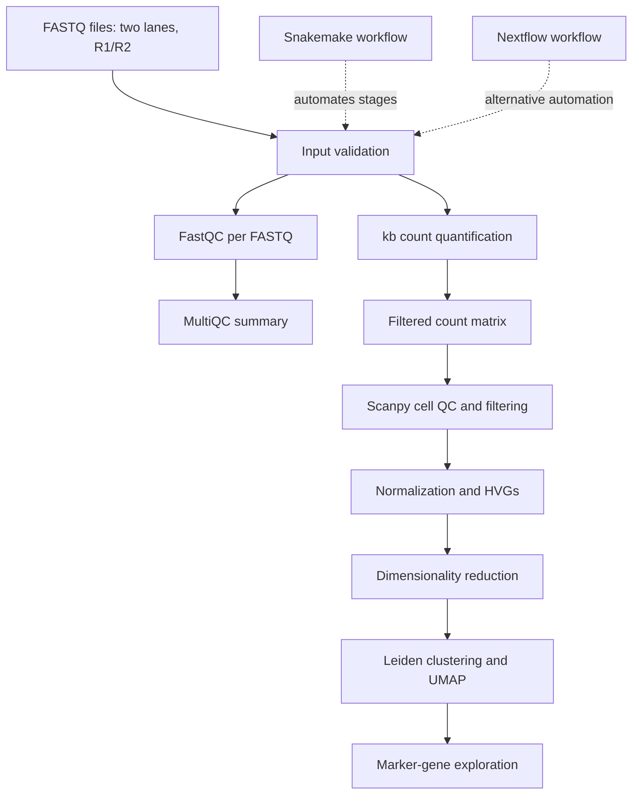
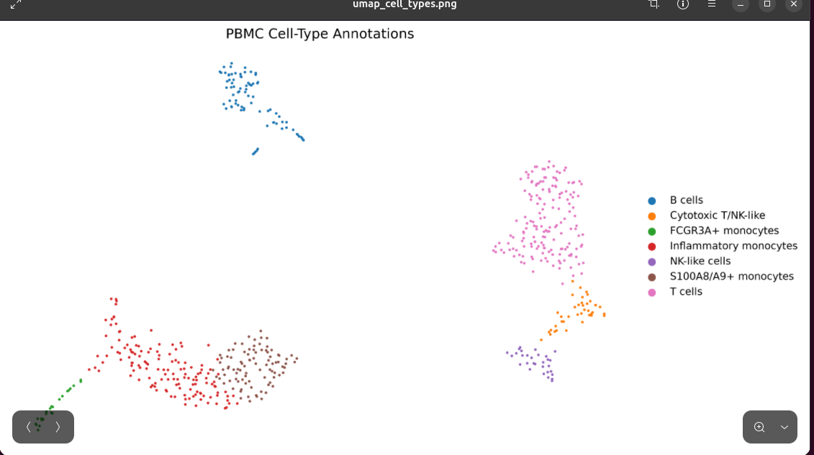

# CellScope
### Reproducible single-cell RNA-seq analysis with Scanpy, Snakemake and Nextflow

CellScope is an exploratory single-cell RNA-seq project built around a public 10x Genomics PBMC dataset. The workflow connects FASTQ validation, read-level quality control, transcript quantification, cell-level analysis, marker exploration, and workflow automation.

The plots and terminal captures embedded below are **actual project artifacts/screenshots**, not recreated mockups. Results from the FASTQ-derived analysis and the earlier matrix-based analysis are reported separately because they came from different branches.

---

## Dataset

**Source:** [10x Genomics — 1k PBMCs from a Healthy Donor, 3′ v3 chemistry](https://www.10xgenomics.com/datasets/1-k-pb-m-cs-from-a-healthy-donor-v-3-chemistry-3-standard-3-0-0)

- Biological material: human peripheral blood mononuclear cells (PBMCs)
- Chemistry: 10x Chromium 3′ v3
- Input: paired-end FASTQ data in two lanes
- Configured sample: `PBMC_1K`
- Working data: a subset of the public dataset, not the complete official dataset
- Official 10x reference analysis reports 1,222 detected cells; this smaller working analysis is not expected to reproduce that number exactly.

For this chemistry, Read 1 contains cell barcode and UMI information, while Read 2 contains transcript sequence. The configured `kb-python` technology is `10XV3`.

## Workflow



### Main stages performed

1. Validate expected input FASTQ files and sample configuration.
2. Run FastQC on R1 and R2 from both lanes.
3. Aggregate reports using MultiQC.
4. Quantify transcript abundance using `kb count` and a configured human transcriptome index.
5. Load the quantification matrix for downstream Scanpy analysis.
6. Inspect cell-level QC metrics, filter cells, select highly variable genes, reduce dimensionality, cluster cells, and generate UMAP visualizations.
7. Export marker-gene tables and summaries.
8. Maintain Snakemake and Nextflow workflow definitions for reproducible execution.

## Results

### Read-level QC and quantification

| Metric | Recorded result |
|---|---:|
| Read pairs across input lanes | 7,685,925 |
| FASTQ files processed by FastQC | 8 |
| Filtered matrix barcodes before Scanpy filtering | 263 |
| Gene rows in filtered matrix | 39,546 |
| Non-zero matrix entries | 514,014 |
| Reported pseudoalignment rate | ~58.0% |
| Reported unique pseudoalignment rate | ~14.6% |

The MultiQC report was written to `results/fastqc/multiqc/multiqc_report.html`. Quantification output was recorded under `results/quantification/PBMC_1K/counts_filtered/`.

Pseudoalignment percentages are the values recorded during this run. They are not, on their own, proof of correct biological assignment.

### FASTQ-derived Scanpy branch

Outputs are under `results/fastq_analysis/PBMC_1K/`.

| Metric | Recorded result |
|---|---:|
| Barcodes before filtering | 263 |
| Cells retained after filtering | 262 |
| Median genes per cell | 1,785 |
| Median counts/UMIs per cell | 5,493 |
| Median mitochondrial fraction | 10.73% |
| Highly variable genes | 2,000 |
| Clusters | 5 |

The branch includes `analysis_summary.json`, `analysis_summary.txt`, `cell_qc_metrics.csv`, `gene_annotations.csv`, `pbmc_fastq_clustered.h5ad`, `cluster_marker_genes.csv`, `top_markers_per_cluster.csv`, and `umap_clusters.png`.

### Actual UMAP — matrix-based analysis branch

The following are actual plots generated during the project from the earlier matrix-based branch. This branch is distinct from the FASTQ-derived branch above.


The matrix-based branch recorded 713 cells before filtering and 567 retained cells across 33,538 genes, with 2,000 highly variable genes and seven Leiden clusters.

| Leiden cluster | Cells |
|---:|---:|
| 0 | 165 |
| 1 | 139 |
| 2 | 91 |
| 3 | 79 |
| 4 | 39 |
| 5 | 30 |
| 6 | 24 |
| **Total** | **567** |

The cell-type annotations are exploratory hypotheses informed by marker genes; they are not independently validated cell identities.

### Other matrix-based branch outputs

| Metric | Recorded result |
|---|---:|
| Full marker table rows | 234,766 |
| Pathway-enrichment table rows | 1,873 |

These values are **row counts**, not necessarily numbers of unique significant genes or unique pathways. Statistical thresholds and multiple-testing correction should be checked in the scripts/output tables before stronger claims are made.

## Selected terminal evidence

The following are genuine screenshots supplied from the CellScope work session. They document the actual project outputs and workflow activity.

### Matrix-based branch summary


### FastQC execution


### UMAP / annotation work



### Nextflow execution evidence


Additional genuine terminal captures are preserved in [`assets/terminal/`](assets/terminal/).

## Workflow execution

### Snakemake

First inspect the planned DAG:

```bash
snakemake -s workflow/snakemake/Snakefile --cores 2 -n
```

If the plan is correct and configured inputs are available, run:

```bash
snakemake -s workflow/snakemake/Snakefile --cores 2
```

### Nextflow

Workflow file: `workflow/nextflow/main.nf`

The recorded run on 16 October 2026 completed:

- `VALIDATE_FASTQ`
- `FASTQC`
- `MULTIQC`
- `QUANTIFY`
- `DOWNSTREAM_SCANPY`

Recorded duration was approximately 14 minutes 18 seconds, with three succeeded tasks and two cached tasks. Cache status depends on the local work directory and whether task inputs and parameters have changed.

```bash
./nextflow run workflow/nextflow/main.nf
```

Use additional parameters if required by the version of the workflow checked into the repository.

## Configuration

Recorded `config/config.yaml`:

```yaml
fastq_dir: data/raw/fastq_small
reference_index: data/reference/kb/human.idx
transcript_to_gene: data/reference/kb/transcripts_to_genes.txt
technology: 10XV3
threads: 2
memory: 2G
```

The sample sheet is `config/samples.tsv`. The configured sample `PBMC_1K` uses these four lane files:

```text
subset_pbmc_1k_v3_S1_L001_R1_001.fastq.gz
subset_pbmc_1k_v3_S1_L001_R2_001.fastq.gz
subset_pbmc_1k_v3_S1_L002_R1_001.fastq.gz
subset_pbmc_1k_v3_S1_L002_R2_001.fastq.gz
```

## Recorded software versions

| Tool | Version |
|---|---|
| Python | 3.12 |
| Scanpy | 1.12.4 |
| MultiQC | 1.35 |
| kb-python | 0.30.2 |
| Snakemake | 9.27.0 |
| Nextflow | 26.10.2 |

Exact reproduction also depends on the FASTQ subset, transcriptome index and transcript-to-gene mapping, configuration, workflow code, and compatible software versions.

## Repository structure

```text
CellScope/
├── README.md
├── config/
│   ├── config.yaml
│   └── samples.tsv
├── workflow/
│   ├── snakemake/
│   │   └── Snakefile
│   └── nextflow/
│       └── main.nf
├── scripts/
├── assets/
│   ├── figures/
│   │   ├── umap_clusters.png
│   │   └── umap_cell_types.png
│   └── terminal/
└── docs/
```

Large FASTQ files, reference indices, and generated results are excluded from Git tracking to keep the repository lightweight.

## Tools used

- **Read-level QC:** FastQC, MultiQC
- **Quantification:** kb-python / kallisto-bustools
- **Single-cell analysis:** Scanpy, AnnData, NumPy, pandas
- **Visualization:** UMAP and Leiden cluster plots
- **Workflow automation:** Snakemake, Nextflow
- **Computational workflow:** Linux shell, YAML configuration, tabular output inspection

## Limitations

- The workflow uses a working subset rather than the complete official dataset.
- FASTQ-derived and matrix-based results represent separate analysis branches and should not be combined.
- Cluster labels are numerical groups; biological labels require marker-based review.
- Table row counts do not automatically equal counts of unique significant genes or pathways.
- QC metrics and pseudoalignment rates need context and are not universal pass/fail criteria.
- This is an exploratory bioinformatics analysis, not a clinical diagnostic pipeline.

## Data source

[10x Genomics — 1k PBMCs from a Healthy Donor (v3 chemistry)](https://www.10xgenomics.com/datasets/1-k-pb-m-cs-from-a-healthy-donor-v-3-chemistry-3-standard-3-0-0). Follow the data provider's attribution and licensing terms.
