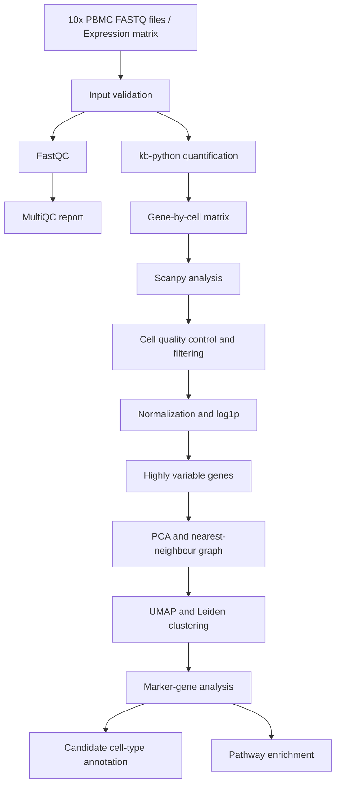
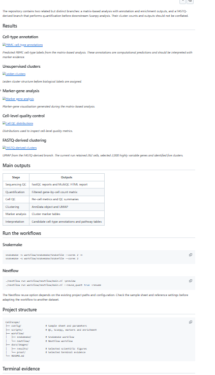
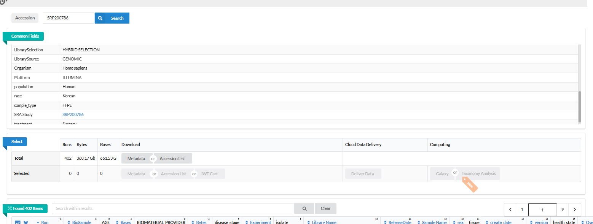
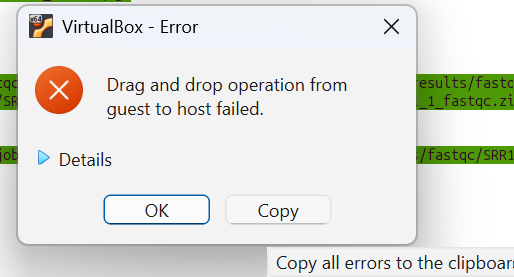

# CellScope

### Single-Cell RNA-seq Analysis and Reproducible Workflow Automation

CellScope is a computational biology project focused on single-cell RNA
sequencing (scRNA-seq) analysis and workflow automation. The project
combines sequencing quality control, transcript quantification,
cell-level filtering, dimensionality reduction, clustering, marker-gene
analysis, exploratory cell-type annotation, and pathway enrichment.

**Tools:** Python · Scanpy · AnnData · kb-python · FastQC · MultiQC ·
GSEApy · Enrichr · Snakemake · Nextflow · Linux · Git

------------------------------------------------------------------------

## 1. Project Overview

The objective of CellScope was to develop and organize a reproducible
computational workflow for analyzing single-cell gene-expression data,
exploring immune-cell populations, and interpreting cluster-associated
biological signals.

The project contains two separate analysis branches:

-   **FASTQ-based branch:** Begins with sequencing reads and includes
    read-level quality control, transcript quantification, and
    downstream single-cell analysis.
-   **Matrix-based branch:** Begins with a gene-expression matrix and
    focuses on cell-level quality control, clustering, marker-gene
    analysis, candidate cell-type annotation, and pathway enrichment.

These branches have different input data and processing histories. Their
cell counts, cluster numbers, and statistical results are reported
separately.

## 2. Dataset and Input Data

**Dataset:** 10x Genomics --- 1k PBMCs from a Healthy Donor, 3′ v3
chemistry.

The dataset contains single-cell RNA-seq data from human peripheral
blood mononuclear cells (PBMCs). PBMCs are a mixture of immune cells
that can include T cells, B cells, natural killer (NK) cells, and
monocytes.

### Dataset characteristics

  -----------------------------------------------------------------------
  Property                            Description
  ----------------------------------- -----------------------------------
  Biological material                 PBMCs from a healthy human donor

  Sequencing technology               10x Chromium 3′ v3 chemistry

  Input format                        Paired-end FASTQ files

  FASTQ organization                  Two sequencing lanes with R1 and R2
                                      reads

  Quantification tool                 kb-python

  Reference                           Configured human transcriptome
                                      reference and transcript-to-gene
                                      mapping

  Downstream analysis                 Scanpy and AnnData
  -----------------------------------------------------------------------

The FASTQ-based branch used a working subset of the public dataset
rather than the complete official dataset. The official dataset reports
approximately 1,222 detected cells; the working subset is not expected
to reproduce that number.

The matrix-based branch used a separate expression-matrix input. Its
results must not be combined with the FASTQ-derived results as if both
branches represented the same processed matrix.

## 3. Workflow



### Main processing stages

1.  Validated FASTQ inputs and sample configuration.
2.  Assessed sequencing-read quality using FastQC.
3.  Aggregated quality-control reports using MultiQC.
4.  Quantified transcripts using kb-python and the configured human
    reference.
5.  Loaded expression data for downstream analysis.
6.  Applied cell-level quality control and filtering.
7.  Normalized expression and applied a log1p transformation.
8.  Selected highly variable genes.
9.  Performed PCA, nearest-neighbour graph construction, UMAP, and
    Leiden clustering.
10. Examined cluster-associated marker genes.
11. Explored candidate immune-cell identities and biological pathways.
12. Organized computational steps using Snakemake and Nextflow.

Not every stage was performed identically in both branches.

## 4. Results: FASTQ-Based Analysis

The FASTQ-based branch began with paired-end sequencing reads and
proceeded through quality assessment, transcript quantification, and
downstream Scanpy analysis.

### Read-level quality control and quantification

  Metric                                       Recorded result
  -------------------------------------- ---------------------
  Input read pairs                                   7,685,925
  FASTQ files processed by FastQC                            8
  Recorded pseudoalignment rate            Approximately 58.0%
  Recorded uniquely pseudoaligned rate     Approximately 14.6%

The pseudoalignment rates are run-specific observations and should be
interpreted in the context of the reference, read configuration, and
quantification settings.

### Cell-level results

  Metric                             Recorded result
  -------------------------------- -----------------
  Barcodes before cell filtering                 263
  Cells retained after filtering                 262
  Genes in the filtered matrix                39,546
  Non-zero matrix entries                    514,014
  Median genes per cell                        1,785
  Median counts per cell                       5,493
  Median mitochondrial fraction               10.73%
  Highly variable genes                        2,000
  Leiden clusters                                  5

The recorded filtering configuration used a minimum of 200 detected
genes per cell and a minimum of three cells per gene.

### Interpretation

The FASTQ-based analysis retained 262 cells from 263 barcodes before
filtering. It identified 2,000 highly variable genes and five
computational clusters.

The median genes per cell, median counts per cell, and mitochondrial
fraction describe different aspects of the expression data and cell
quality. They should be interpreted together rather than as independent
proof of data quality.

### FASTQ-derived clusters


*The figure above is the existing cluster visualization. Confirm its
source branch before describing it specifically as FASTQ-derived.*

## 5. Results: Matrix-Based Analysis

The matrix-based branch used a separate gene-expression matrix for
downstream analysis.

### Cell filtering

The recorded filtering criteria were:

-   At least 200 detected genes per cell.
-   At least 500 counts per cell.
-   Less than 20% mitochondrial expression.

  Metric                              Recorded result
  --------------------------------- -----------------
  Cells assessed before filtering                 713
  Cells retained after filtering                  567
  Cells removed by filtering                      146
  Genes in the analysis matrix                 33,538
  Highly variable genes                         2,000
  Leiden clusters                                   7

The filtering step retained approximately 79.5% of the initially
assessed cells.

### Normalization and dimensionality reduction

Expression was normalized to a target of 10,000 counts per cell and
transformed using `log1p`.

The purpose of normalization was to reduce differences associated with
total counts per cell. The log transformation compressed the range of
expression values.

The recorded downstream steps included:

-   **Highly variable genes:** 2,000 genes selected using Scanpy's
    Seurat method.
-   **Scaling:** Prepared selected features for downstream analysis.
-   **PCA:** Summarized major patterns of variation.
-   **Nearest-neighbour graph:** Represented relationships between
    cells.
-   **UMAP:** Visualized cells in a lower-dimensional space.
-   **Leiden clustering:** Grouped cells using a recorded resolution of
    0.5.

The matrix-based branch produced seven clusters, whereas the FASTQ-based
branch produced five. These results come from different analysis
branches and should not be interpreted as a direct comparison of the
same input matrix.

### Matrix-based cluster visualization


*UMAP visualizes the relationships between cells. Leiden clusters are
computational groupings and do not independently establish biological
cell identity.*

### Exploratory cell-type annotation


The exploratory annotation included candidate populations such as:

-   T cells
-   B cells
-   Cytotoxic lymphocytes
-   NK-like cells
-   Inflammatory monocytes
-   S100A8/A9-high monocytes
-   FCGR3A-positive monocytes

These are candidate annotations informed by marker expression. They
should not be described as experimentally confirmed identities.

## 6. Marker-Gene Analysis

Marker-gene analysis was performed using the Wilcoxon rank-sum test.

Marker genes help identify genes whose expression distinguishes one
cluster from other cells. These genes can provide evidence for
interpreting clusters and proposing candidate cell types.

Canonical immune-cell marker expression was examined to assess whether
the proposed annotations were biologically plausible.

  Metric                                Recorded result
  ---------------------------- ------------------------
  Marker-analysis method         Wilcoxon rank-sum test
  Recorded marker-table rows                    234,766

The marker-table row count is the recorded number of rows, not
necessarily the number of unique genes or statistically significant
markers.

Marker-gene findings require consideration of effect sizes, adjusted
p-values, expression patterns, and biological context.

## 7. Pathway-Enrichment Analysis

Pathway enrichment was performed using GSEApy with Enrichr's **GO
Biological Process 2023** gene-set library.

The recorded selection criteria were:

-   Adjusted p-value below 0.05.
-   Log fold change above 0.25.
-   At least five selected genes per cluster.

### Reported biological themes

-   Inflammatory responses and cytokine production.
-   T-cell activation and receptor signalling.
-   Cytotoxicity.
-   Antigen presentation.
-   Translation-related processes.

These themes varied by cluster and depend on the selected genes and
analysis settings.

  Metric                                     Recorded result
  ----------------------------- ----------------------------
  Enrichment library              GO Biological Process 2023
  Enrichment tool                        GSEApy with Enrichr
  Recorded pathway-table rows                          1,873

The 1,873 rows represent the recorded pathway-table size, not
necessarily 1,873 unique or significant pathways.

Enrichment analysis identifies biological processes represented in a
gene list. It does not independently prove that a pathway is activated
or that a biological process caused the observed expression pattern.

## 8. Workflow Automation

### Snakemake

The recorded Snakemake workflow was located at
`workflow/snakemake/Snakefile`.

A dry run was performed using:

``` bash
snakemake -s workflow/snakemake/Snakefile --cores 2 -n
```

The recorded dry run reported that expected outputs were up to date.
This demonstrated how Snakemake uses declared inputs, outputs, and
dependencies to determine which jobs need to run.

### Nextflow

The recorded Nextflow workflow was located at
`workflow/nextflow/main.nf`.

The recorded stages were:

1.  `VALIDATE_FASTQ`
2.  `FASTQC`
3.  `MULTIQC`
4.  `QUANTIFY`
5.  `DOWNSTREAM_SCANPY`

  Metric                       Recorded result
  ---------------------------- -----------------------
  Approximate runtime          14 minutes 18 seconds
  Tasks that succeeded         3
  Tasks retrieved from cache   2

Cached tasks reused existing outputs rather than necessarily being
recomputed during that execution.

Snakemake organizes analysis using rules with declared inputs and
outputs. Nextflow organizes work using processes connected through
dataflow channels. Both help make computational workflows more
structured and reproducible.

### Nextflow execution evidence



## 9. Quality-Control and Analysis Evidence

### FastQC processing



### Matrix-based analysis summary



### Cell-type annotation evidence


These screenshots supplement the scientific figures and workflow
definitions. Screenshots alone do not establish reproducibility; the
underlying scripts, parameters, input files, and output tables are also
important.

## 10. Main Outputs

  -----------------------------------------------------------------------
  Stage                               Outputs
  ----------------------------------- -----------------------------------
  Input validation                    FASTQ and sample-configuration
                                      checks

  Sequencing QC                       FastQC reports and MultiQC HTML
                                      report

  Quantification                      Filtered gene-by-cell expression
                                      matrix

  Cell-level QC                       Per-cell metrics and filtering
                                      summaries

  Dimensionality reduction            PCA and UMAP representations

  Clustering                          Leiden cluster assignments

  Marker analysis                     Cluster-associated marker tables

  Biological interpretation           Candidate cell-type annotations

  Pathway enrichment                  Enrichment result tables

  Workflow automation                 Snakemake and Nextflow definitions
                                      and execution logs
  -----------------------------------------------------------------------

## 11. Challenges and Lessons Learned

  -----------------------------------------------------------------------
  Challenge                           Lesson learned
  ----------------------------------- -----------------------------------
  Quality-report aggregation          MultiQC must receive the intended
                                      FastQC reports.

  Workflow dependencies               Inputs and outputs must be
                                      explicitly connected between
                                      stages.

  Nextflow caching                    Cached outputs must be
                                      distinguished from newly executed
                                      tasks.

  Separate analysis branches          Results from different inputs and
                                      filtering histories must remain
                                      separate.

  Cell-type interpretation            Clustering requires marker evidence
                                      for biological interpretation.

  Statistical interpretation          Table row counts are not
                                      necessarily counts of unique
                                      significant results.

  Reproducibility                     Configuration files, scripts,
                                      workflow definitions, and version
                                      control support repeatable
                                      analysis.
  -----------------------------------------------------------------------

## 12. Important Results at a Glance

### FASTQ-based branch

  Result                                Value
  ------------------------------- -----------
  Input read pairs                  7,685,925
  Cells retained                          262
  Genes in filtered matrix             39,546
  Highly variable genes                 2,000
  Clusters                                  5
  Median genes per cell                 1,785
  Median counts per cell                5,493
  Median mitochondrial fraction        10.73%

### Matrix-based branch

  Result                                           Value
  ----------------------------- ------------------------
  Cells before filtering                             713
  Cells retained                                     567
  Genes in analysis matrix                        33,538
  Highly variable genes                            2,000
  Clusters                                             7
  Normalization target            10,000 counts per cell
  Leiden resolution                                  0.5
  Recorded marker-table rows                     234,766
  Recorded pathway-table rows                      1,873

## 13. Limitations

-   The FASTQ-based branch used a working subset rather than the
    complete official dataset.
-   The FASTQ-based and matrix-based branches used separate inputs and
    filtering histories.
-   Results depend on preprocessing, filtering thresholds, reference
    files, and analysis parameters.
-   UMAP is a visualization technique and does not independently
    establish cell identity.
-   Marker-gene analysis and pathway enrichment depend on statistical
    settings and selected genes.
-   Table row counts do not automatically represent unique significant
    genes or pathways.
-   Candidate cell-type labels require biological validation.
-   The dataset represents one healthy donor and cannot establish
    population-wide biological conclusions.
-   Workflow execution success does not, by itself, establish scientific
    validity.
-   Reproducibility requires the appropriate input data, reference
    files, software versions, configuration, and scripts.

## 14. References and Tools

-   **Dataset:** 10x Genomics --- 1k PBMCs from a Healthy Donor, 3′ v3
    chemistry.
-   **Scanpy and AnnData:** Single-cell expression processing and
    analysis.
-   **kb-python:** Transcript quantification.
-   **FastQC and MultiQC:** Sequencing-read quality assessment and
    reporting.
-   **GSEApy and Enrichr:** Gene-set and pathway-enrichment analysis.
-   **Snakemake and Nextflow:** Workflow automation.
-   **Python and Linux:** Computational analysis and scripting.
-   **Git:** Version control.

## Author

**Ankur Kumar**

Bioinformatics · Single-cell genomics · NGS workflow automation
