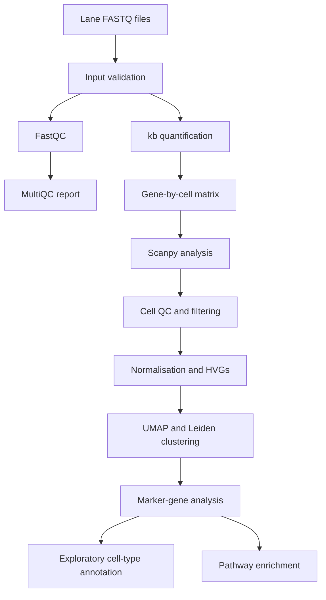

# CellScope
### Single-cell RNA-seq analysis with Scanpy, Snakemake and Nextflow

CellScope is a practical bioinformatics project using PBMC single-cell RNA-seq data. It connects sequencing quality control, transcript quantification, cell-level analysis, clustering, marker-gene investigation and exploratory cell-type annotation in documented workflows.

**Tools:** Python · Scanpy · AnnData · kb-python · FastQC · MultiQC · Snakemake · Nextflow

---

## Workflow



The repository contains two related but distinct branches: a matrix-based analysis with annotation and enrichment outputs, and a FASTQ-derived branch that performs quantification before downstream Scanpy analysis. Their cluster counts and outputs should not be conflated.

## Results

### Cell-type annotation


*Predicted PBMC cell-type labels from the matrix-based analysis. These annotations are computational predictions and should be interpreted with marker evidence.*

### Unsupervised clusters


*Leiden cluster structure before biological labels are assigned.*

### Marker-gene analysis


*Marker-gene visualisation generated during the matrix-based analysis.*

### Cell-level quality control


*Distributions used to inspect cell-level quality metrics.*

### FASTQ-derived clustering


*UMAP from the FASTQ-derived branch. The current run retained 262 cells, selected 2,000 highly variable genes and identified five clusters.*

## Main outputs

| Stage | Outputs |
|---|---|
| Sequencing QC | FastQC reports and MultiQC HTML report |
| Quantification | Filtered gene-by-cell count matrix |
| Cell QC | Per-cell metrics and QC summaries |
| Clustering | AnnData object and UMAP |
| Marker analysis | Cluster marker tables |
| Interpretation | Candidate cell-type annotations and pathway tables |

## Run the workflows

### Snakemake

```bash
snakemake -s workflow/snakemake/Snakefile --cores 2 -n
snakemake -s workflow/snakemake/Snakefile --cores 2
```

### Nextflow

```bash
./nextflow run workflow/nextflow/main.nf -preview
./nextflow run workflow/nextflow/main.nf --reuse_quant true -resume
```

The Nextflow reuse option depends on the existing project paths and configuration. Check the sample sheet and reference settings before adapting the workflow to another dataset.

## Project structure

```text
CellScope/
├── config/                 # Sample sheet and parameters
├── scripts/                # QC, Scanpy, markers and enrichment
├── workflow/
│   ├── snakemake/          # Snakemake workflow
│   └── nextflow/           # Nextflow workflow
├── docs/images/
│   ├── results/            # Selected scientific figures
│   └── proof/              # Selected terminal evidence
└── README.md
```

## Terminal evidence

The following captures document different stages of the work. They supplement the scripts and outputs; screenshots alone do not establish reproducibility.

<details>
<summary><strong>Open implementation evidence (6 screenshots)</strong></summary>

### 1. Canonical marker validation


### 2. Pathway analysis


### 3. Analysis summary


*This capture belongs to the matrix-based branch; the FASTQ-derived branch has its own output summary.*

### 4. FASTQ validation and QC


### 5. Generated results


### 6. Successful Nextflow run


*Shows successful completion of validation, FastQC, MultiQC, quantification and downstream Scanpy.*

</details>

## Reproducibility notes

- Parameters and sample information are stored in `config/`.
- The workflows and analysis scripts are version-controlled.
- Raw data, local environments, temporary files and generated results are excluded from the main Git repository.
- Cell-type labels and pathway enrichment are exploratory interpretations, not definitive biological conclusions.
- Reference provenance and software versions should be recorded when reproducing the analysis in a clean environment.

## Author

**Ankur Kumar** · Bioinformatics · Single-cell genomics · NGS workflow automation
