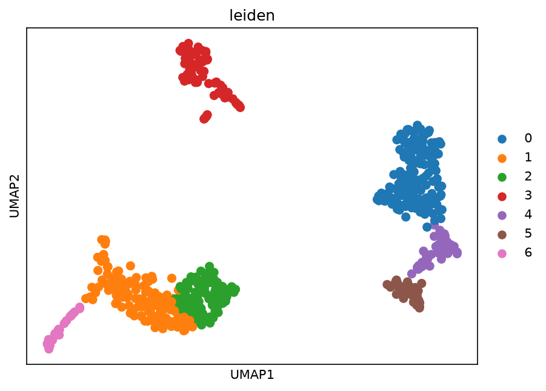
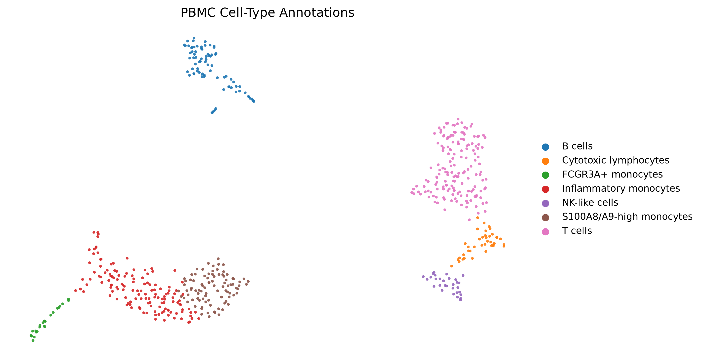

# CellScope
### Reproducible Single-Cell RNA-seq Analysis

CellScope is a bioinformatics portfolio project demonstrating single-cell RNA-seq quality control, transcript quantification, downstream analysis, visualization, and workflow automation.

**Tools:** Python · Scanpy · AnnData · kb-python · FastQC · MultiQC · Snakemake · Nextflow · Git

## Dataset

**10x Genomics: 1k PBMCs from a Healthy Donor (3′ v3 chemistry)**

The dataset contains human peripheral blood mononuclear cell sequencing data used to demonstrate single-cell analysis.

- [Official dataset and experimental details](https://www.10xgenomics.com/datasets/1-k-pb-m-cs-from-a-healthy-donor-v-3-chemistry-3-standard-3-0-0)
- [Scanpy documentation](https://scanpy.readthedocs.io/)
- [kb-python documentation](https://kallisto.readthedocs.io/projects/kb-python/en/latest/)

## Workflow

1. Validate FASTQ inputs and sample configuration.
2. Assess sequencing quality using FastQC.
3. Aggregate quality reports using MultiQC.
4. Quantify transcripts using kb-python.
5. Perform downstream single-cell analysis using Scanpy.
6. Explore cell clusters and marker genes.
7. Automate execution using Snakemake and Nextflow.

## Results

The project contains two separate analysis branches. Their results are reported independently because their inputs and cell counts differ.

### FASTQ-based analysis

| Metric | Result |
|---|---:|
| Input read pairs | 7,685,925 |
| Barcodes before filtering | 263 |
| Cells retained | 262 |
| Median genes per cell | 1,785 |
| Median counts per cell | 5,493 |
| Median mitochondrial fraction | 10.73% |
| Highly variable genes | 2,000 |
| Clusters identified | 5 |
| Approximate pseudoalignment rate | 58.0% |
| Approximate uniquely pseudoaligned rate | 14.6% |

#### Figure 1. FASTQ-based UMAP

### Matrix-based analysis

| Metric | Result |
|---|---:|
| Cells before filtering | 713 |
| Cells retained | 567 |
| Genes in analysis matrix | 33,538 |
| Highly variable genes | 2,000 |
| Clusters identified | 7 |
| Rows in full marker table | 234,766 |
| Rows in pathway-enrichment table | 1,873 |

The marker and pathway figures above represent table row counts, not necessarily unique genes or pathways.

#### Figure 2. Matrix-based UMAP

#### Figure 3. Cell-type annotation

*Interpretation note:* UMAP shows cells in a reduced-dimensional space. Cluster separation alone does not establish cell identity; cell-type labels should be supported by marker-gene evidence.

## Quality Control

FastQC was used to inspect sequencing-read quality, and MultiQC was used to aggregate the individual reports.

Expected local report location:

`results/fastqc/multiqc/multiqc_report.html`

## Workflow Automation

### Snakemake

Workflow file: `workflow/snakemake/Snakefile`

Dry-run command:

    snakemake -s workflow/snakemake/Snakefile --cores 2 -n

### Nextflow

Workflow file: `workflow/nextflow/main.nf`

The recorded successful run included input validation, FastQC, MultiQC, quantification, and downstream Scanpy analysis. Some tasks were retrieved from cache.

## Repository Structure

    CellScope/
    ├── config/
    ├── data/
    ├── results/
    ├── scripts/
    ├── workflow/
    │   ├── snakemake/
    │   └── nextflow/
    ├── assets/
    │   └── figures/
    └── README.md

Large input data and generated outputs may be excluded from Git through `.gitignore`.

## Limitations

- The FASTQ-based and matrix-based branches use different inputs and must not be treated as one analysis.
- Results from a subset of reads may differ from the complete official dataset analysis.
- Clustering and cell-type annotation require biological validation.
- Pathway-enrichment results depend on the input gene list and analysis settings.

## References

1. 10x Genomics. [1k PBMCs from a Healthy Donor (v3 chemistry)](https://www.10xgenomics.com/datasets/1-k-pb-m-cs-from-a-healthy-donor-v-3-chemistry-3-standard-3-0-0)
2. Scanpy. [Documentation](https://scanpy.readthedocs.io/)
3. AnnData. [Documentation](https://anndata.readthedocs.io/)
4. kb-python. [Documentation](https://kallisto.readthedocs.io/projects/kb-python/en/latest/)
5. FastQC. [Documentation](https://www.bioinformatics.babraham.ac.uk/projects/fastqc/)
6. MultiQC. [Documentation](https://docs.seqera.io/multiqc/)
7. Snakemake. [Documentation](https://snakemake.readthedocs.io/)
8. Nextflow. [Documentation](https://www.nextflow.io/docs/latest/)

## Author

**Ankur Kumar**

- [GitHub](https://github.com/ANKUR77019)
- [LinkedIn](https://www.linkedin.com/in/ankur-vats-936a9924b/)
