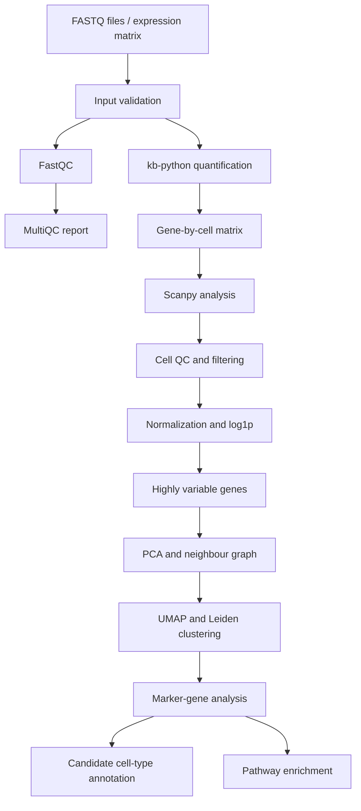

# CellScope

### Single-cell RNA-seq analysis with Scanpy, Snakemake and Nextflow

CellScope is a reproducible computational biology project exploring
single-cell RNA sequencing (scRNA-seq) data from human peripheral blood
mononuclear cells (PBMCs). It brings together sequencing quality
control, transcript quantification, cell-level filtering, dimensionality
reduction, clustering, marker-gene analysis, exploratory cell-type
annotation, pathway enrichment, and workflow automation.

**Tools:** Python · Scanpy · AnnData · kb-python · FastQC · MultiQC ·
GSEApy · Enrichr · Snakemake · Nextflow · Linux · Git

------------------------------------------------------------------------

## Dataset

**Dataset:** 10x Genomics --- *1k PBMCs from a Healthy Donor, 3′ v3
chemistry*

The dataset contains single-cell RNA-seq data from PBMCs, a mixture of
immune cells that can include T cells, B cells, natural killer (NK)
cells, and monocytes.

  -----------------------------------------------------------------------
  Property                            Description
  ----------------------------------- -----------------------------------
  Biological material                 PBMCs from one healthy human donor

  Chemistry                           10x Chromium 3′ v3

  FASTQ inputs                        Paired-end R1/R2 reads across two
                                      lanes

  Quantification                      kb-python using the configured
                                      human transcriptome reference and
                                      transcript-to-gene mapping

  Downstream analysis                 Scanpy and AnnData

  Official dataset context            Approximately 1,222 detected cells
                                      reported for the official dataset

  Project input                       A working subset for the FASTQ
                                      branch plus a separate expression
                                      matrix for the matrix branch
  -----------------------------------------------------------------------

The project uses two distinct branches. The FASTQ-based branch starts
from sequencing reads; the matrix-based branch starts from an expression
matrix. Their cell counts, cluster counts, and results are reported
separately and should not be conflated.

## Workflow



### Main processing stages

1.  Validated FASTQ inputs and sample configuration.
2.  Assessed read quality with FastQC and consolidated reports using
    MultiQC.
3.  Quantified transcripts with kb-python and the configured reference.
4.  Loaded expression data for downstream Scanpy analysis.
5.  Applied cell-level quality control and filtering.
6.  Normalized expression to 10,000 counts per cell in the matrix branch
    and applied `log1p`.
7.  Selected 2,000 highly variable genes.
8.  Applied PCA, nearest-neighbour graph construction, UMAP, and Leiden
    clustering.
9.  Examined cluster-associated marker genes.
10. Explored candidate immune-cell identities and biological pathways.
11. Organized computational steps using Snakemake and Nextflow.

Not every stage was applied identically in both branches.

## Results

### 1. FASTQ-based analysis

This branch started with paired-end sequencing reads, then performed
read-level quality control, transcript quantification, and downstream
single-cell analysis.

#### Read-level QC and quantification

  Metric                                   Recorded result
  -------------------------------------- -----------------
  Input read pairs                               7,685,925
  FASTQ files processed by FastQC                        8
  Recorded pseudoalignment rate                    \~58.0%
  Recorded uniquely pseudoaligned rate             \~14.6%

These pseudoalignment rates are run-specific values and should be
interpreted in the context of the reference, read configuration, and
quantification settings.

#### Cell-level results

  Metric                            Recorded result
  ------------------------------- -----------------
  Barcodes before filtering                     263
  Cells retained                                262
  Genes in filtered matrix                   39,546
  Non-zero matrix entries                   514,014
  Median genes per cell                       1,785
  Median counts per cell                      5,493
  Median mitochondrial fraction              10.73%
  Highly variable genes                       2,000
  Leiden clusters                                 5

The recorded filtering configuration used a minimum of 200 detected
genes per cell and a minimum of three cells per gene.

### 2. Matrix-based analysis

This branch used a separate expression matrix for cell filtering,
clustering, marker analysis, candidate annotation, and pathway
enrichment.

#### Cell filtering and clustering

  Metric                                     Recorded result
  --------------------------------- ------------------------
  Cells assessed before filtering                        713
  Cells retained after filtering                         567
  Cells removed                                          146
  Genes in analysis matrix                            33,538
  Highly variable genes                                2,000
  Leiden clusters                                          7
  Normalization target                10,000 counts per cell
  Leiden resolution                                      0.5

Recorded matrix-branch filtering criteria:

-   At least 200 detected genes per cell.
-   At least 500 counts per cell.
-   Less than 20% mitochondrial expression.

The filtering retained approximately 79.5% of the 713 cells assessed.

### Cell-type annotation


*Candidate PBMC cell-type labels from the matrix-based analysis. These
are computational annotations and should be interpreted alongside
marker-gene evidence.*

The exploratory annotations included candidate T cells, B cells,
cytotoxic lymphocytes, NK-like cells, inflammatory monocytes,
S100A8/A9-high monocytes, and FCGR3A-positive monocytes. These labels
were not experimentally confirmed.

### Unsupervised clusters


*Leiden cluster structure before biological labels are assigned. UMAP
visualizes cells in a lower-dimensional space; it does not independently
prove cell identity.*

### Marker-gene analysis


Marker genes were examined using the Wilcoxon rank-sum test to identify
expression patterns that distinguish clusters and support candidate
cell-type interpretation.

  Metric                                Recorded result
  ---------------------------- ------------------------
  Marker-analysis method         Wilcoxon rank-sum test
  Recorded marker-table rows                    234,766

The row count is the recorded table size, not necessarily the number of
unique genes or statistically significant markers.

### Cell-level quality control


Cell-level QC metrics help assess detected genes, total counts, and
mitochondrial expression before downstream interpretation.

### FASTQ-derived clustering


*The FASTQ-based branch retained 262 cells, selected 2,000 highly
variable genes, and identified five clusters. Verify the source of this
figure before presenting it as specific to the FASTQ branch.*

## Pathway enrichment

Pathway enrichment used GSEApy with Enrichr's **GO Biological Process
2023** gene-set library.

Recorded selection criteria:

-   Adjusted p-value below 0.05.
-   Log fold change above 0.25.
-   At least five selected genes per cluster.

Reported themes included inflammatory responses and cytokine production,
T-cell activation and receptor signalling, cytotoxicity, antigen
presentation, and translation-related processes.

  Metric                                     Recorded result
  ----------------------------- ----------------------------
  Enrichment tool                        GSEApy with Enrichr
  Gene-set library                GO Biological Process 2023
  Recorded pathway-table rows                          1,873

The 1,873 rows are a table row count, not necessarily 1,873 unique or
significant pathways. Enrichment highlights biological processes
represented in selected gene lists; it does not by itself prove pathway
activation or causation.

## Workflow automation

### Snakemake

The recorded workflow was located at `workflow/snakemake/Snakefile`.

A dry run was performed with:

``` bash
snakemake -s workflow/snakemake/Snakefile --cores 2 -n
```

The recorded dry run reported that expected outputs were up to date.
This illustrates how Snakemake uses declared inputs, outputs, and
dependencies to decide which jobs need to run.

### Nextflow

The recorded workflow was located at `workflow/nextflow/main.nf`.

Recorded stages:

1.  `VALIDATE_FASTQ`
2.  `FASTQC`
3.  `MULTIQC`
4.  `QUANTIFY`
5.  `DOWNSTREAM_SCANPY`

  Metric                       Recorded result
  ---------------------------- -----------------------
  Approximate runtime          14 minutes 18 seconds
  Tasks succeeded              3
  Tasks retrieved from cache   2

Cached tasks reused existing outputs and were not necessarily recomputed
during that run.


## Main outputs

  Stage             Outputs
  ----------------- -------------------------------------------------------
  Sequencing QC     FastQC reports and MultiQC HTML report
  Quantification    Filtered gene-by-cell expression matrix
  Cell QC           Per-cell metrics and filtering summaries
  Clustering        AnnData object, Leiden assignments, and UMAP
  Marker analysis   Cluster-associated marker tables
  Interpretation    Candidate cell-type annotations and pathway tables
  Automation        Snakemake and Nextflow definitions and execution logs

## Terminal evidence

These screenshots document selected stages of the project. They
supplement, but do not replace, the underlying scripts, configuration,
input data, and output tables.

```{=html}
<details>
```
```{=html}
<summary>
```
`<strong>`{=html}Open implementation evidence (6
screenshots)`</strong>`{=html}
```{=html}
</summary>
```
### 1. Marker validation


### 2. Pathway analysis


### 3. Matrix-based analysis summary


*This capture belongs to the matrix-based branch; the FASTQ-derived
branch has separate results.*

### 4. FASTQ quality control


### 5. Generated outputs


### 6. Nextflow execution


```{=html}
</details>
```
## Reproducibility notes

-   Configuration, sample information, and workflow definitions should
    be retained with the project.
-   The FASTQ-based and matrix-based results must remain separate
    because they use different inputs and filtering histories.
-   Raw data, reference indices, local environments, temporary files,
    and generated outputs may be excluded from Git to keep the
    repository manageable.
-   Cell-type labels and pathway-enrichment findings are exploratory and
    require biological review.
-   Software versions, reference provenance, and parameters should be
    recorded to support reproduction.

## Limitations

-   The FASTQ branch used a working subset rather than the complete
    official dataset.
-   Results depend on preprocessing, filtering thresholds, reference
    files, and analysis settings.
-   UMAP is a visualization method and does not independently establish
    biological identity.
-   Marker and enrichment results depend on statistical thresholds and
    selected genes.
-   Table row counts do not automatically equal counts of unique
    significant genes or pathways.
-   The data represent one healthy donor and cannot establish
    population-wide conclusions.
-   Successful workflow execution does not by itself establish
    scientific validity.

## Dataset and software

-   **Dataset:** 10x Genomics --- 1k PBMCs from a Healthy Donor, 3′ v3
    chemistry.
-   **Single-cell analysis:** Scanpy and AnnData.
-   **Transcript quantification:** kb-python.
-   **Sequencing QC:** FastQC and MultiQC.
-   **Enrichment:** GSEApy and Enrichr.
-   **Workflow automation:** Snakemake and Nextflow.
-   **Environment and version control:** Linux, Python, and Git.

## Author

**Ankur Kumar** · Bioinformatics · Single-cell genomics · NGS workflow
automation
