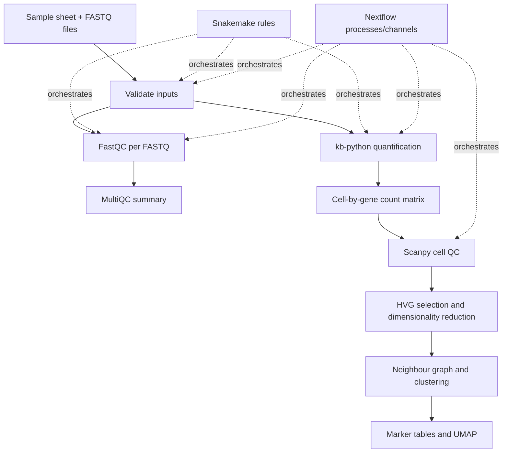

# CellScope
### A reproducible single-cell RNA-seq workflow using Scanpy, Snakemake and Nextflow

CellScope is a portfolio project demonstrating an end-to-end workflow for a small 10x Genomics PBMC single-cell RNA-seq dataset: input validation, read-level quality control, barcode/UMI-aware quantification, cell-level analysis, and workflow orchestration.

**Repository:** [ANKUR77019/CellScope](https://github.com/ANKUR77019/CellScope)  
**Dataset:** [10x Genomics — 1k PBMCs from a Healthy Donor (v3 chemistry)](https://www.10xgenomics.com/datasets/1-k-pbm-cs-from-a-healthy-donor-v-3-chemistry-3-standard-3-0-0)

> **Scope note:** The project contains two distinct analysis branches. Their counts are reported separately because they use different input matrices and processing histories.

## Project at a glance

| Component | Purpose | Main output |
|---|---|---|
| FASTQ validation | Check expected files and sample metadata | Validation log |
| FastQC | Inspect per-file read quality | Individual HTML/ZIP reports |
| MultiQC | Aggregate QC reports | `results/fastqc/multiqc/multiqc_report.html` |
| `kb-python` | Quantify reads with 10x barcode/UMI-aware processing | Filtered cell-by-gene matrix |
| Scanpy | Cell QC, HVGs, embedding, clustering and marker analysis | AnnData, CSV summaries and UMAP |
| Snakemake | Express rule dependencies and up-to-date outputs | `workflow/snakemake/Snakefile` |
| Nextflow | Orchestrate processes and support resumable execution | `workflow/nextflow/main.nf` |

## Dataset and input design

The source dataset is human peripheral blood mononuclear cells (PBMCs) from one healthy donor, generated with 10x Chromium Single Cell 3′ v3 chemistry. Read 1 contains a 16-base cell barcode and a 12-base UMI; Read 2 contains transcript sequence. The official 10x reference analysis reports 1,222 detected cells. That number is the source's reference result, not the retained-cell count in this reanalysis.

The sample sheet describes one sample (`PBMC_1K`) split across two sequencing lanes, with paired R1/R2 files per lane. The recorded FASTQ input total was 7,685,925 read pairs. The lanes are technical partitions, not biological replicates.

## Results

### Branch A — FASTQ-derived analysis

| Metric | Recorded result |
|---|---:|
| Read pairs across lane FASTQs | 7,685,925 |
| Barcodes in `kb-python` filtered output | 263 |
| Gene rows in `kb-python` matrix | 39,546 |
| Non-zero matrix entries | 514,014 |
| Pseudoalignment | ~58.0% |
| Unique pseudoalignment | ~14.6% |
| Cells retained by downstream QC | 262 |
| Median detected genes per cell | 1,785 |
| Median counts/UMIs per cell | 5,493 |
| Median mitochondrial fraction | 10.73% |
| Highly variable genes | 2,000 |
| Clusters in recorded Scanpy output | 5 |

Main outputs are expected under `results/fastq_analysis/PBMC_1K/`, including `analysis_summary.json`, `analysis_summary.txt`, `cell_qc_metrics.csv`, `pbmc_fastq_clustered.h5ad`, marker tables and `umap_clusters.png`. Read-level reports are under `results/fastqc/`.

### Branch B — earlier matrix-based analysis

This branch started from a pre-existing expression matrix, not the small FASTQ-derived matrix.

| Metric | Recorded result |
|---|---:|
| Cells before filtering | 713 |
| Cells retained | 567 |
| Genes in filtered AnnData | 33,538 |
| Highly variable genes | 2,000 |
| Number of clusters | 7 |
| Cluster sizes (IDs 0–6) | 165, 139, 91, 79, 39, 30, 24 |
| Rows in full marker table | 234,766 |
| Rows in pathway output | 1,873 |

The matrix branch has outputs under `results/qc/` and `results/analysis/`, including QC summaries, filtered/clustered AnnData, cluster assignments, marker tables, pathway tables and UMAP figures.

**Do not combine Branch A and Branch B.** The cell counts and cluster counts differ because these are separate inputs/processing histories. The 1,873 pathway figure is a row count, not automatically 1,873 unique pathways; interpretation requires checking pathway IDs, the enrichment method, background gene universe and multiple-testing threshold.

## Workflow overview

## Workflow automation evidence

A recorded Nextflow run on 16 October 2026 completed these stages:

- `VALIDATE_FASTQ`
- `FASTQC`
- `MULTIQC`
- `QUANTIFY`
- `DOWNSTREAM_SCANPY`

Recorded runtime was 14 minutes 18 seconds; the summary showed three processes succeeded and two were cached. The successful run listed `QUANTIFY` as completed, so this documentation does **not** claim that `--reuse_quant true` skipped quantification.

The Snakemake dry run reported that requested targets were up to date at the time it was checked. That verifies workflow state at that moment, not correctness of every scientific parameter.

## Reproducibility notes and limitations

- One healthy donor: this is not a replicated case-control study and does not support population-level inference.
- The FASTQ-derived branch is a subset/reanalysis; its 262 retained cells should not be presented as the original dataset's total cell count.
- UMAP is a visualisation, not a statistical test. Cluster count depends on preprocessing and graph/clustering settings.
- Exact reference release, software versions, QC cutoffs, normalization parameters, marker test, and pathway-enrichment settings should be recorded from the actual scripts/logs before making detailed methodological claims.
- Raw data and large generated results are excluded from Git in the current repository design. The source and regeneration instructions should therefore remain clear.
- Figures should only be embedded after the actual files are committed at the referenced paths. No image links are included here that point to assumed filenames.

## Documentation

- [`docs/TECHNICAL_REPORT.md`](docs/TECHNICAL_REPORT.md) — methods, outputs, interpretation and limitations.
- [`docs/SENIOR_HANDOFF.md`](docs/SENIOR_HANDOFF.md) — concise review of the Snakemake and Nextflow implementation.
- [`docs/INTERVIEW_GUIDE.md`](docs/INTERVIEW_GUIDE.md) — revision notes and interview questions.

## Data source

10x Genomics, *1k PBMCs from a Healthy Donor (v3 chemistry)*: https://www.10xgenomics.com/datasets/1-k-pbm-cs-from-a-healthy-donor-v-3-chemistry-3-standard-3-0-0. The source page describes the dataset, read structure, reference analysis and license. Retain source attribution and follow the stated license.
