# CellScope

**A reproducible single-cell RNA-seq analysis project with Scanpy, kb-python, Snakemake, and Nextflow**

CellScope explores single-cell RNA sequencing (scRNA-seq) data from human peripheral blood mononuclear cells (PBMCs). It brings together sequencing quality control, transcript quantification, cell-level quality control, dimensionality reduction, clustering, marker-gene analysis, exploratory cell-type annotation, pathway enrichment, and workflow automation.

**Core stack:** Python · Scanpy · AnnData · kb-python · FastQC · MultiQC · GSEApy · Enrichr · Snakemake · Nextflow · Linux · Git

## Contents

- [Project overview](#project-overview)
- [Dataset](#dataset)
- [Workflow architecture](#workflow-architecture)
- [Results](#results)
- [Pathway enrichment](#pathway-enrichment)
- [Workflow automation](#workflow-automation)
- [Main outputs](#main-outputs)
- [Reproducibility and limitations](#reproducibility-and-limitations)
- [Implementation evidence](#implementation-evidence)

## Project overview

The project demonstrates two complementary analysis routes:

| Route | Starts with | Main purpose |
|---|---|---|
| **FASTQ-based** | Paired-end sequencing reads from two lanes | Read-level QC, transcript quantification, and downstream single-cell analysis |
| **Matrix-based** | A separate gene-expression matrix | Cell filtering, clustering, marker-gene analysis, candidate annotation, and pathway enrichment |

These are **separate branches with different inputs and filtering histories**. Their cell counts, cluster counts, and results are reported independently throughout this README.

## Dataset

**Dataset:** 10x Genomics — *1k PBMCs from a Healthy Donor, 3′ v3 chemistry*

PBMCs are a mixture of immune cells that may include T cells, B cells, natural killer (NK) cells, and monocytes. This makes the dataset useful for exploring how expression patterns and marker genes can help distinguish immune-cell populations.

| Property | Description |
|---|---|
| Biological material | PBMCs from one healthy human donor |
| Platform chemistry | 10x Chromium 3′ v3 |
| FASTQ inputs | Paired-end R1/R2 reads across two lanes |
| FASTQ quantification | kb-python with the configured human transcriptome reference and transcript-to-gene mapping |
| Downstream analysis | Scanpy and AnnData |
| Official dataset context | Approximately 1,222 detected cells reported for the official dataset |
| Project inputs | A working FASTQ subset and a separate expression matrix for the matrix-based branch |

The results below describe the project runs and should not be interpreted as a reanalysis of every cell in the complete official dataset.

## Workflow architecture

### FASTQ-based route

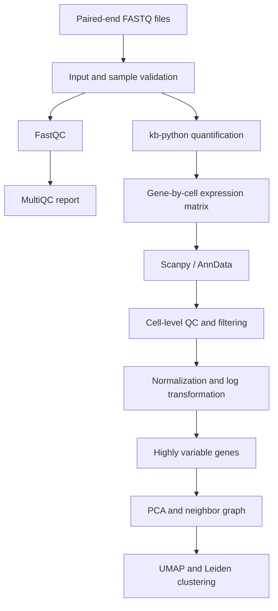

### Matrix-based route

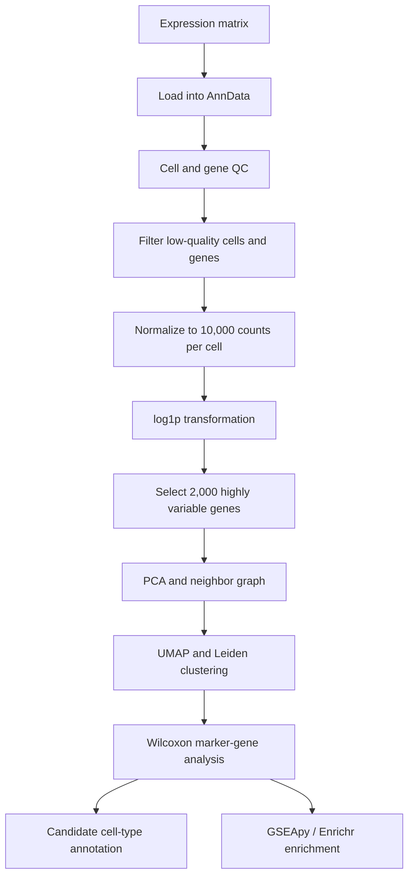

### Main processing stages

1. Validate input files and sample configuration.
2. Assess sequencing-read quality with FastQC and aggregate reports with MultiQC.
3. Quantify transcripts from the FASTQ inputs with kb-python and the configured reference.
4. Represent expression data in a gene-by-cell matrix and load it into AnnData for downstream analysis.
5. Apply cell-level quality control and filtering using the branch-specific criteria described below.
6. Normalize matrix-branch expression to 10,000 counts per cell and apply `log1p` transformation.
7. Select 2,000 highly variable genes for downstream representation.
8. Use PCA and a nearest-neighbor graph to support UMAP visualization and Leiden clustering.
9. Identify cluster-associated marker genes and use them to explore candidate cell identities.
10. Explore biological themes with gene-set enrichment and organize computational stages with workflow managers.

Not every stage or parameter was applied identically in both branches.

## Results

### 1. FASTQ-based analysis

This branch began with paired-end sequencing reads and continued through read-level QC, transcript quantification, and downstream single-cell analysis.

#### Read-level QC and quantification

| Metric | Recorded result |
|---|---:|
| Input read pairs | 7,685,925 |
| FASTQ files processed by FastQC | 8 |
| Pseudoalignment rate | ~58.0% |
| Uniquely pseudoaligned rate | ~14.6% |

These are run-specific quantification values. They depend on the reference, read configuration, transcript-to-gene mapping, and quantification settings; they should not be treated as universal performance benchmarks.

#### Cell-level results

| Metric | Recorded result |
|---|---:|
| Barcodes before filtering | 263 |
| Cells retained | 262 |
| Genes in filtered matrix | 39,546 |
| Non-zero matrix entries | 514,014 |
| Median genes per cell | 1,785 |
| Median counts per cell | 5,493 |
| Median mitochondrial fraction | 10.73% |
| Highly variable genes | 2,000 |
| Leiden clusters | 5 |

The recorded filtering configuration used a minimum of **200 detected genes per cell** and a minimum of **3 cells per gene**. The FASTQ branch retained 262 cells from 263 barcodes before filtering.


*UMAP of the FASTQ-based branch. The run retained 262 cells and identified five Leiden clusters.*

### 2. Matrix-based analysis

This branch used a separate expression matrix for cell filtering, clustering, marker analysis, candidate annotation, and pathway enrichment.

#### Cell filtering and clustering

| Metric | Recorded result |
|---|---:|
| Cells assessed before filtering | 713 |
| Cells retained after filtering | 567 |
| Cells removed | 146 |
| Genes in analysis matrix | 33,538 |
| Highly variable genes | 2,000 |
| Leiden clusters | 7 |
| Normalization target | 10,000 counts per cell |
| Leiden resolution | 0.5 |

**Cell-filtering criteria**

- At least 200 detected genes per cell.
- At least 500 total counts per cell.
- Mitochondrial expression fraction below 20%.

The filtering retained approximately **79.5%** of the 713 cells assessed. These thresholds are analysis choices, not universal rules; their suitability depends on dataset quality and biological context.

#### Candidate cell-type annotation

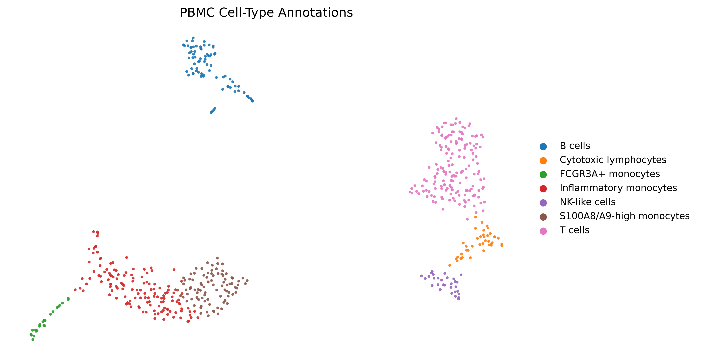

*Candidate PBMC cell-type labels inferred from the matrix-based analysis. Labels are exploratory and should be assessed against marker-gene evidence.*

The exploratory annotations included candidate T cells, B cells, cytotoxic lymphocytes, NK-like cells, inflammatory monocytes, S100A8/A9-high monocytes, and FCGR3A-positive monocytes. These labels were not experimentally confirmed.

#### Unsupervised clusters


*Leiden clusters before biological labels are assigned. UMAP places cells in a lower-dimensional visualization space; visual separation alone does not establish cell identity.*

#### Marker-gene analysis

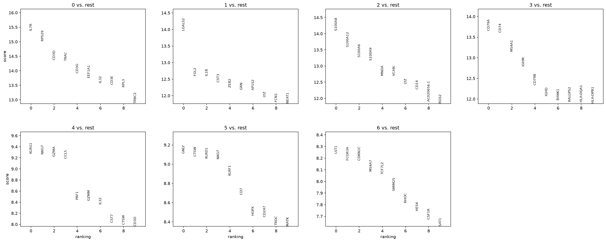

Marker genes were examined using the **Wilcoxon rank-sum test** to identify genes with expression patterns that distinguish clusters and support candidate cell-type interpretation.

| Metric | Recorded result |
|---|---:|
| Marker-analysis method | Wilcoxon rank-sum test |
| Marker-table rows | 234,766 |

The 234,766 figure is the recorded table row count. It does not necessarily represent the number of unique genes or statistically significant markers.

#### Cell-level quality control

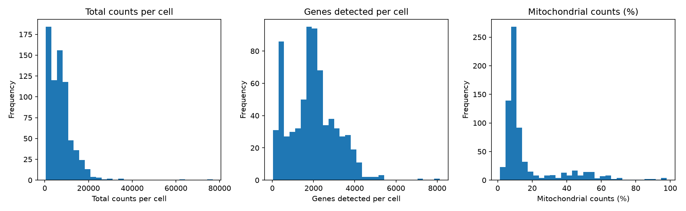

Cell-level QC metrics help assess detected genes, total counts, and mitochondrial expression before downstream interpretation. QC plots should be considered alongside the distribution of each metric and the expected biology of the sample.

## Pathway enrichment

Pathway enrichment used **GSEApy** with Enrichr's **GO Biological Process 2023** gene-set library.

**Recorded selection criteria**

- Adjusted p-value below 0.05.
- Log fold change above 0.25.
- At least five selected genes per cluster.

Reported themes included inflammatory responses and cytokine production, T-cell activation and receptor signaling, cytotoxicity, antigen presentation, and translation-related processes.

| Metric | Recorded result |
|---|---:|
| Enrichment tool | GSEApy with Enrichr |
| Gene-set library | GO Biological Process 2023 |
| Pathway-table rows | 1,873 |

The 1,873 figure is a table row count, not necessarily the number of unique or significant pathways. Enrichment results indicate over-representation of genes associated with annotated biological processes; they do not by themselves prove pathway activation, causation, or experimental validation.

## Workflow automation

### Snakemake

The Snakemake workflow is located at `workflow/snakemake/Snakefile`.

A dry run was performed with:

```bash
snakemake -s workflow/snakemake/Snakefile --cores 2 -n
```

The recorded dry run reported that expected outputs were up to date. A dry run previews the jobs Snakemake would execute without running those jobs; this helps check the workflow's dependency graph and output status before execution.

### Nextflow

The Nextflow workflow is located at `workflow/nextflow/main.nf`.

**Recorded stages**

1. `VALIDATE_FASTQ`
2. `FASTQC`
3. `MULTIQC`
4. `QUANTIFY`
5. `DOWNSTREAM_SCANPY`

| Metric | Recorded result |
|---|---:|
| Approximate runtime | 14 minutes 18 seconds |
| Tasks succeeded | 3 |
| Tasks retrieved from cache | 2 |

Cached tasks reused existing outputs and were not necessarily recomputed during that run. Runtime and cache behavior depend on the input files, execution environment, and workflow configuration.

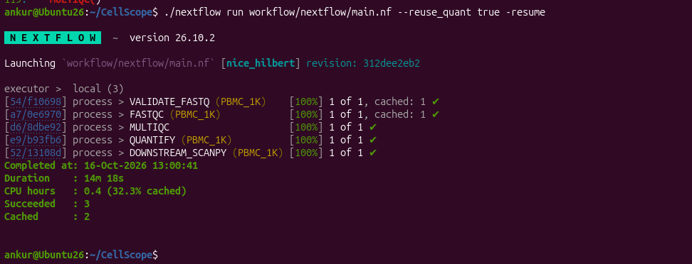

## Main outputs

| Stage | Outputs or evidence |
|---|---|
| Sequencing QC | FastQC reports and a MultiQC HTML report |
| Quantification | Gene-by-cell expression matrix |
| Cell QC | Per-cell metrics and filtering summaries |
| Clustering | AnnData object, Leiden assignments, and UMAP figures |
| Marker analysis | Cluster-associated marker tables |
| Interpretation | Candidate cell-type annotations and pathway-enrichment tables |
| Workflow automation | Snakemake and Nextflow definitions and execution logs |

## Reproducibility and limitations

- **Separate analysis branches:** FASTQ-derived and matrix-based results use different inputs and filtering histories. Their statistics should not be combined.
- **Working subset:** The FASTQ branch used a working subset, not every cell in the complete official dataset.
- **Single donor:** The dataset represents one healthy donor, so findings cannot establish population-wide patterns or generalize to disease samples.
- **Exploratory annotation:** Cell-type labels are candidate interpretations based on expression and marker evidence, not experimentally confirmed identities.
- **Visualization:** UMAP is useful for exploring structure but does not independently establish cell identity or prove that groups are biologically distinct.
- **Statistical interpretation:** Marker and enrichment results depend on thresholds, selected genes, and the analysis design. Table row counts are not automatically counts of unique significant genes or pathways.
- **Workflow execution:** A successful run or an up-to-date dry run supports workflow operation but does not, by itself, establish scientific validity.
- **Reproduction:** Exact reproduction also depends on input files, reference provenance, software versions, parameters, and environment configuration being retained with the project.

## Implementation evidence

The following screenshots document selected analysis and workflow stages. They supplement the scripts, configuration, input data, and output tables rather than replacing them.

<details>
<summary><strong>Open implementation evidence (6 screenshots)</strong></summary>

### 1. Marker validation

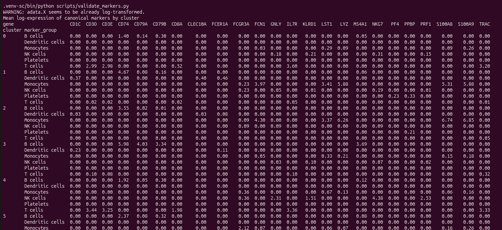

### 2. Pathway analysis

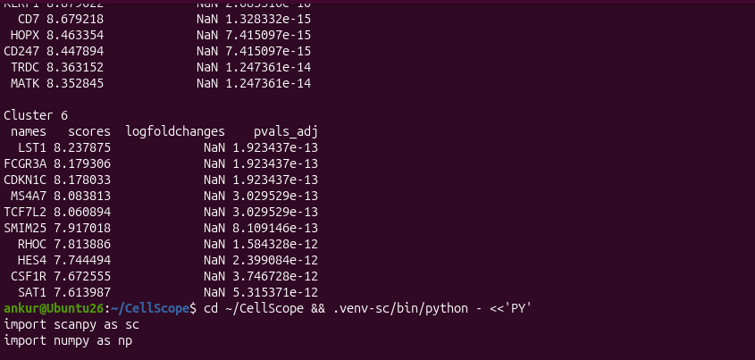

### 3. Matrix-based analysis summary

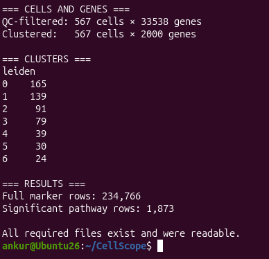

*This capture documents the matrix-based branch; it should not be read as the FASTQ branch's summary.*

### 4. FASTQ quality control

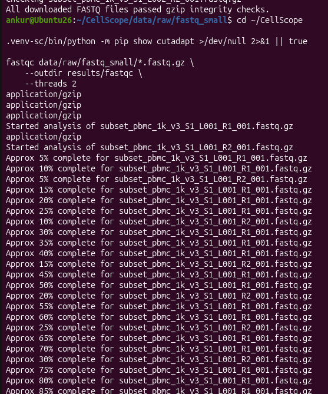

### 5. Generated outputs

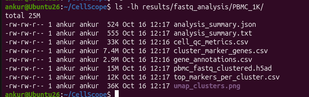

### 6. Nextflow execution


</details>

## Tools and methods

| Area | Tools or methods |
|---|---|
| Read quality control | FastQC, MultiQC |
| Transcript quantification | kb-python |
| Single-cell data structure | AnnData |
| QC, preprocessing, and visualization | Scanpy, PCA, UMAP |
| Clustering | Leiden |
| Marker-gene testing | Wilcoxon rank-sum test |
| Functional enrichment | GSEApy, Enrichr, GO Biological Process 2023 |
| Workflow automation | Snakemake, Nextflow |
| Environment and version control | Linux, Python, Git |

## Author

**Ankur Kumar**  
Bioinformatics · Single-cell genomics · NGS workflow automation
