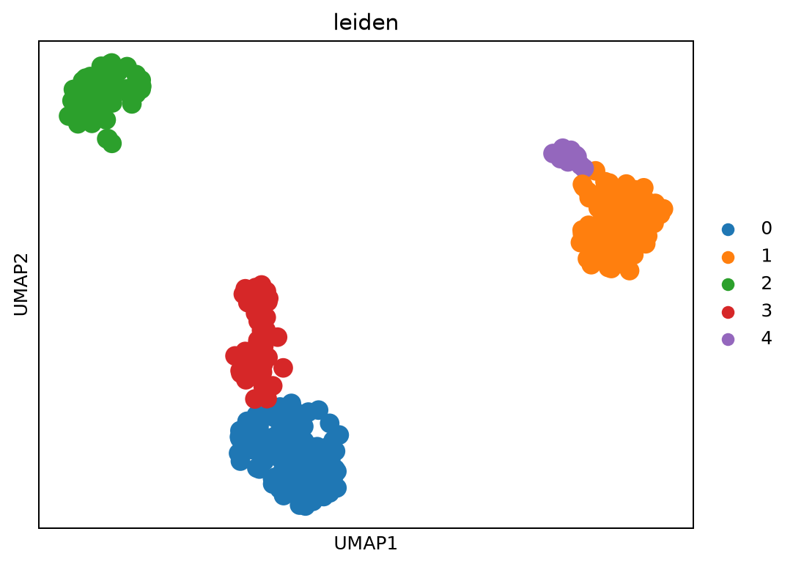

# CellScope
### Reproducible Single-Cell RNA-seq Analysis

CellScope is a portfolio project demonstrating single-cell RNA-seq quality control, transcript quantification, downstream analysis and workflow automation using Scanpy, kb-python, FastQC, MultiQC, Snakemake and Nextflow.

## Dataset and Reference

The project uses public human peripheral blood mononuclear cell (PBMC) sequencing data.

**Primary dataset reference:**  
Zheng et al., 10x Genomics — *1k PBMCs from a Healthy Donor (v3 chemistry)*.

- [Official dataset and experimental details](https://www.10xgenomics.com/datasets/1-k-pb-m-cs-from-a-healthy-donor-v-3-chemistry-3-standard-3-0-0)
- [Scanpy documentation](https://scanpy.readthedocs.io/)
- [kb-python documentation](https://kallisto.readthedocs.io/projects/kb-python/en/latest/)
- [Snakemake documentation](https://snakemake.readthedocs.io/)
- [Nextflow documentation](https://www.nextflow.io/docs/latest/)

## Workflow

1. Validate FASTQ input files and sample configuration.
2. Assess sequencing quality with FastQC.
3. Aggregate quality-control reports with MultiQC.
4. Quantify transcript abundance with kb-python.
5. Perform downstream single-cell analysis with Scanpy.
6. Explore dimensionality reduction, clusters and marker genes.
7. Automate workflow execution with Snakemake and Nextflow.

## Results and Figures

All available analysis figures are grouped below. Each figure is generated from a project output and has its own caption. Results from the FASTQ-based and matrix-based analyses are kept separate because their input data and cell counts differ.

<table>
  <tr>
    <td align="center" width="50%">
      
       <b>Figure 1. FASTQ-based analysis</b>
       UMAP visualization of clusters from the PBMC_1K FASTQ-based branch.
    </td>
    <td align="center" width="50%">
      
       <b>Figure 2. Matrix-based analysis</b>
       UMAP visualization of clusters from the separate matrix-based branch.
    </td>
  </tr>
  <tr>
    <td align="center" colspan="2">
      
       <b>Figure 3. Cell-type annotations</b>
       Cell-type visualization from the matrix-based branch. Interpret labels according to the marker-validation results.
    </td>
  </tr>
</table>

## Analysis Notes

The FASTQ-based branch and matrix-based branch are separate analyses. Their statistics must not be combined or presented as though they came from the same input matrix.

UMAP plots show the arrangement of cells in a reduced-dimensional representation; cluster separation alone does not establish cell identity. Cell-type labels require biological interpretation and validation using appropriate marker genes.

## Reproducibility

Configuration files are maintained in `config/`, analysis scripts in `scripts/`, and workflow definitions in `workflow/`. Large raw data and generated results are excluded from version control where configured in `.gitignore`.

## Author

**Ankur Kumar**

- [GitHub](https://github.com/ANKUR77019)
- [LinkedIn](https://www.linkedin.com/in/ankur-vats-936a9924b/)
